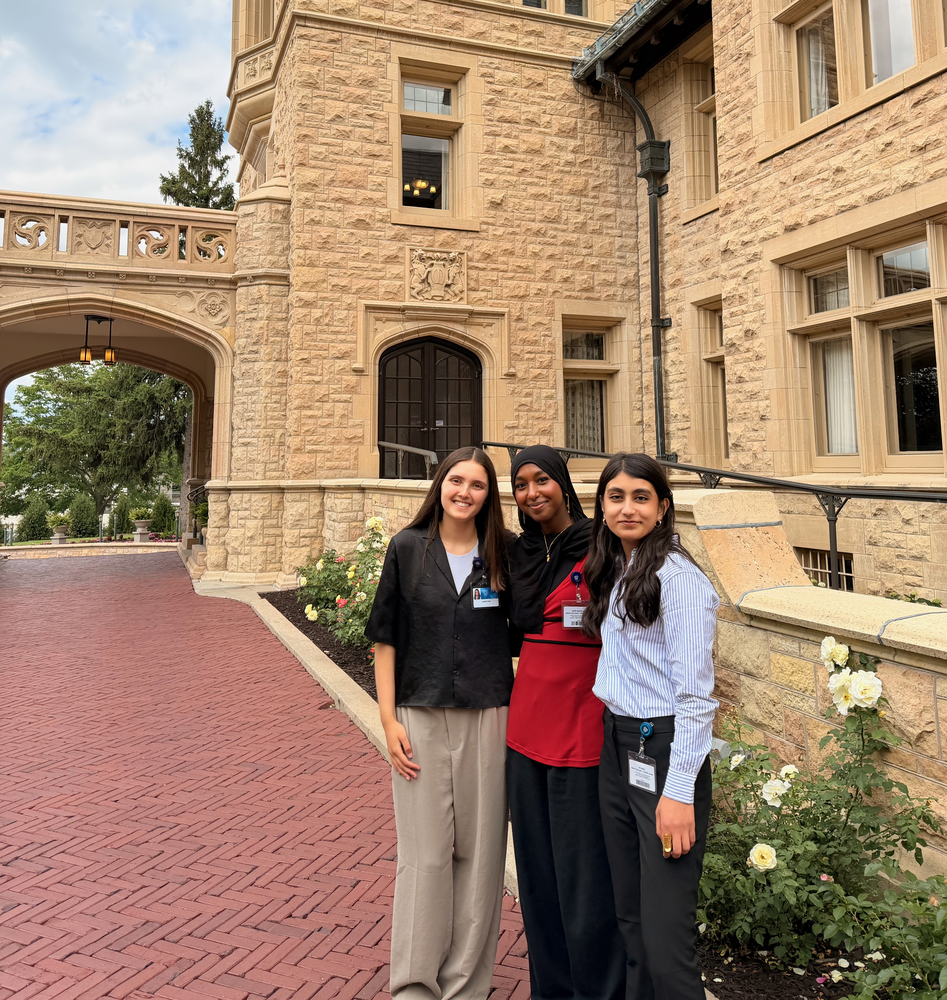
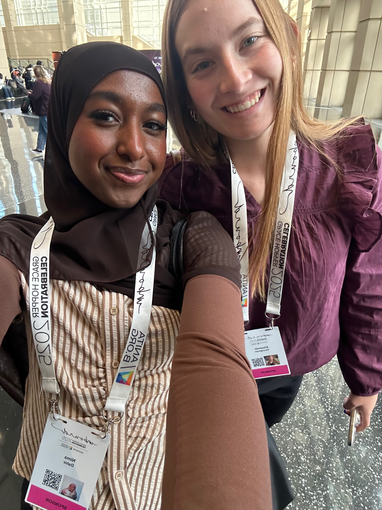
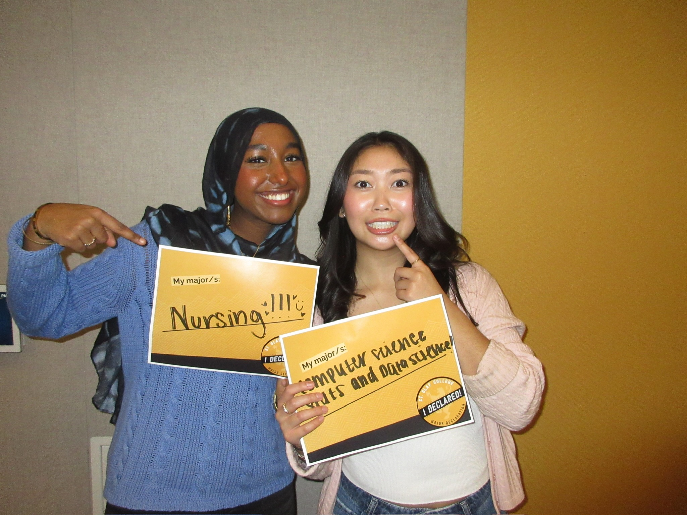

Hi, I'm Nima! I'm a Somali-American junior from Rochester, Minnesota studying Computer Science and Statistics & Data Science at St. Olaf College. I'm especially interested in artificial intelligence, machine learning, and data science, and how technology can be used to make a positive impact.

At St. Olaf, I'm involved in several campus organizations and departments, including the Admissions Office, SOAR, the IE&A, the NSM Action Team, the MSCS Department, and the Muslim Student Association, among others. I love getting involved on campus, meeting new people, and finding ways to contribute to my community.

Outside of St. Olaf, I've had the opportunity to intern at Mayo Clinic as both an ELMS Intern and a Data Science & AI Intern. These experiences strengthened my interest in using technology, AI, and data to make a meaningful difference in people's lives, especially in healthcare and medical technology. This upcoming summer, I'll be joining Boston Scientific as a Data Science & AI Intern!

Outside of academics and work, I love spending time with friends, trying new activities, traveling (this January I will be in Denmark + Germany), exploring coffee shops, watching la liga + soccer games, and thrift shopping.

I'm always excited to learn something new, take on challenges, and explore opportunities where I can combine my interests in technology, data, and helping others!

  

  

  

